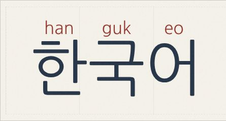

# HanCue

**Hangul, with a little help above.** HanCue adds small Latin reading cues above
Korean syllables. The cues are built into the font, so your text stays Korean.



Created by [@yrezgui](https://github.com/yrezgui) with AI, inspired by
[Furifont](https://furifont.antfu.me/).

## Download

[Download all fonts](fonts/HanCue-All.zip) — includes TTF and WOFF2 files,
original licenses, font credits, and installation instructions.

| Font | Based on | Desktop | Web |
| --- | --- | --- | --- |
| HanCue Serif | Nanum Myeongjo | [TTF](fonts/HanCueSerif-Regular.ttf) | [WOFF2](fonts/HanCueSerif-Regular.woff2) |
| HanCue Sans | Nanum Gothic | [TTF](fonts/HanCueSans-Regular.ttf) | [WOFF2](fonts/HanCueSans-Regular.woff2) |
| HanCue Script | Nanum Pen Script | [TTF](fonts/HanCueScript-Regular.ttf) | [WOFF2](fonts/HanCueScript-Regular.woff2) |

All three fonts cover **11,172 modern Hangul syllables**. Install a TTF file on
your computer, then select its HanCue family in an app that supports custom fonts.

## Try the website

This folder contains everything needed to serve the site:

```text
github/
├── index.html
├── styles.css
├── app.js
├── README.md
├── LICENSE
├── cue-preview.jpg
└── fonts/
```

From this folder, run:

```sh
python3 -m http.server 8000 --bind 127.0.0.1
```

Open [localhost:8000](http://localhost:8000). You can also publish these files
with GitHub Pages or another static host; no build step is needed.

The playground lets you enter Korean, choose a font, change the size, and hide
the cues. The two font selectors stay in sync, and the download links follow
your selection. Text is processed locally in your browser.

## Use on your website

```css
@font-face {
  font-family: "HanCue Sans";
  src: url("fonts/HanCueSans-Regular.woff2") format("woff2");
  font-weight: 400;
  font-display: swap;
}

.korean {
  font-family: "HanCue Sans", sans-serif;
  font-size: 48px;
  line-height: 1.75;
}
```

```html
<p class="korean" lang="ko">한글</p>
```

The font supplies the cues without JavaScript. To hide them, set
`font-feature-settings: "ss01" 1`. Leave enough line height for the guides.

## Reading cues

Each syllable is annotated independently using Revised Romanization letter
values. For example, 한국어 displays **han · guk · eo**. These cues help identify
the syllables; pronunciation in connected speech can differ. Conventions such
as `eo`, `eu`, and `ui` are not English phonetic spellings.

Standalone jamo and historical Hangul have no annotations. Copying text keeps
the original Korean. Apps without color-font support can display the complete
monochrome outlines, including the cues.

## Credits and licenses

HanCue's Latin reading cues are built on top of existing Nanum typefaces,
preserving their original Korean letterforms:

- **Nanum Myeongjo:** NHN Corporation; original typeface designed by FONTRIX.
  [Original license](fonts/NanumMyeongjo-OFL.txt).
- **Nanum Gothic:** NHN Corporation; original typeface designed by Sandoll
  Communications Inc. [Original license](fonts/NanumGothic-OFL.txt).
- **Nanum Pen Script:** NHN Corporation; original typeface designed by Sandoll
  Communications Inc. [Original license](fonts/NanumPenScript-OFL.txt).

Font files and their modifications remain under the **SIL Open Font License
1.1**. The full original license and copyright notices are embedded in each
download and included in the ZIP. The modified fonts use HanCue family names
to respect the original Reserved Font Names. See [font notices](fonts/NOTICE.md).

The independent website code is licensed under [MIT](LICENSE). That license
does not apply to the fonts.
